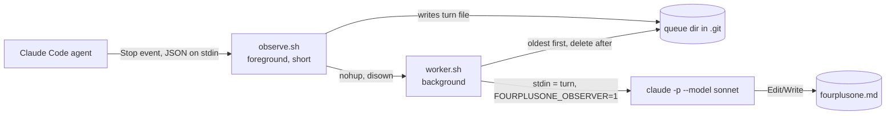

# fourplusone

Your coding agent makes dozens of decisions every turn, and most never reach you. Its summaries sound clear and skip what actually happened. Turn by turn, you lose track of the system you're building.

fourplusone keeps you aligned. After every turn, it updates one file in your repo, `fourplusone.md`, in two parts:

1. **Your system, as it is right now,** described with Philippe Kruchten's 4+1 view model ([the 1995 paper](https://www.cs.ubc.ca/~gregor/teaching/papers/4+1view-architecture.pdf), [Wikipedia](https://en.wikipedia.org/wiki/4%2B1_architectural_view_model)). It covers four views (logical, process, development, physical) plus scenarios that walk through them. Whatever you and the agent agree on lands here.
2. **Every session, turn by turn.** Each turn is walked through step by step, with everything the agent decided or assumed without telling you called out. Anything waiting on you is pinned to the top.

The goal: read only `fourplusone.md`, and you fully understand the system and how it got this way.

## Install

In Claude Code:

```
/plugin marketplace add adhikrysh/fourplusone
/plugin install fourplusone@fourplusone
```

You need `git` and `jq`. macOS already has jq. On Linux, run `sudo apt install jq`. If jq is missing, fourplusone tells you after your next turn.

That's it. It runs in every git repo you open with Claude Code. Outside a git repo, it does nothing.

## What you'll see

A file called `fourplusone.md` appears at your repo root after your first turn and updates after every turn. Open it in your editor's markdown preview, side by side with your agent:

```
┌──────────────────────────┬──────────────────────────┐
│ claude code (terminal)   │ fourplusone.md (preview) │
│                          │                          │
│ > add rate limiting      │ ## Needs you             │
│   ...agent works...      │ - counts stored in       │
│                          │   memory, never said so  │
│                          │ ## 1. Scope ...          │
│                          │ ## 3. Views ...          │
│                          │ ## Sessions ▾            │
└──────────────────────────┴──────────────────────────┘
```

In VS Code or Cursor, open the file and press `Cmd+K V` (`Ctrl+K V` on Windows and Linux) to open the preview beside it. The preview refreshes whenever the file changes. Diagrams are written in Mermaid. If your preview doesn't draw them, install the [Markdown Preview Mermaid Support](https://marketplace.visualstudio.com/items?itemName=bierner.markdown-mermaid) extension.

The file is never pushed. fourplusone adds it to `.git/info/exclude`, git's local-only ignore list, so it stays out of your commits without touching your `.gitignore`.

## Example

This is real output: fourplusone running on its own repo. The developer asked the agent to write an end-to-end test. In turn 1, the agent planned and asked nine questions. In turn 2, the developer approved them all. Full file: [`examples/fourplusone.md`](examples/fourplusone.md).

### Part 1: your system, in 4+1 views

The top of the doc always describes the system as it is right now. On the first run, fourplusone read the repo and wrote the views. This is its process view:

> **Process view.** Boxes are processes. Arrows are how they talk.



> **Known race (found by the agent by reading, not yet reproduced):** worker A sees the queue empty at `worker.sh:19` and leaves the loop. Before its EXIT trap removes the lock (`worker.sh:12`), a new Stop hook adds a turn file and starts worker B. B's `mkdir` fails (`worker.sh:11`) and B exits. The new turn sits in the queue until a later turn starts another worker. I agree the code allows this.

When you agree to something, it lands in the system part. After the developer's approval, the design guidelines updated:

> - Approved by the developer (2026-11-06, "go with all your recommendations"), proposed by the agent: test in a temp copy; artifact in `examples/e2e/`; structural asserts only, no golden match since LLM output varies; …
> - Agent-made after approval, not yet confirmed: heading checks are loose (case-insensitive keywords), not the exact titles approved.

### Part 2: every session, turn by turn

Each turn is walked through step by step. Whatever the agent decided or assumed without you seeing it gets called out, including claims it never checked:

> **Decided or assumed without you seeing it:**
> - ⚠ Replaced "in this repo" with a temp copy (reason given: safety and repeatability).
> - ⚠ Replaced "save to examples/" with `examples/e2e/` (reason given: don't make the README drift).
> - ⚠ Assumed `--plugin-dir`, `--session-id`, `--resume`, `acceptEdits` exist as flags. Not confirmed in visible output.
> - ⚠ Assumed "no commits yet". No command shown.

Anything waiting on you is pinned to the top:

> **Needs you**
> - **`tests/e2e.sh` is still not on disk.** You approved all nine decisions ("go with all your recommendations"). The agent's `Write` was blocked: "… tests/e2e.sh which is a sensitive file." …
> - **Decision 5 was loosened by the agent, after your approval.** You approved exact heading checks (`## Needs you`, `## 3. Views`). The agent … now matches headings case-insensitively …

## How it works

1. When a turn ends, Claude Code runs fourplusone's Stop hook.
2. The hook saves that turn from the session transcript and returns right away, so your agent never waits.
3. In the background, Sonnet reads the turn plus your current `fourplusone.md`, then edits the doc. On a repo's first run, it reads your codebase first and writes the system description.
4. Turns are handled one at a time per repo, so none are lost and the doc never gets garbled.

Sonnet runs through your existing Claude Code login, using `claude -p --model sonnet`. There's no API key and no extra account. It counts against your Claude Code plan the same way your own sessions do, once per turn. The turn goes to Anthropic, where your session already went. Nothing goes anywhere else.

The observer can read your code but can only edit `fourplusone.md`. It can't run commands.

## Limits

- **Claude Code only for now.** Codex support is planned.
- **It only sees what the agent says and does.** It can't see the agent's private reasoning.
- **Edits you make outside an agent session aren't seen** until a later turn touches that code, so the doc can go stale there.
- **Every turn costs one Sonnet run** on your plan.

## Uninstall

```
/plugin uninstall fourplusone@fourplusone
```

Then delete `fourplusone.md` and `.git/fourplusone/` from any repo you want to clean up.

## License

MIT. See [LICENSE](LICENSE).
