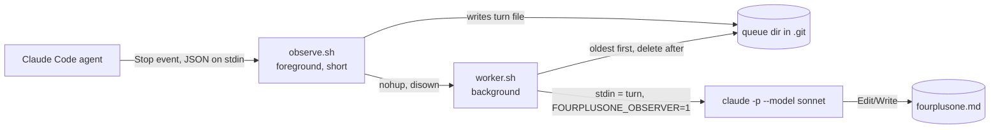

# fourplusone

I kept losing track of what my coding agent was doing. In one turn it would pick a library, set a default, take a shortcut, then sum the whole thing up in two sentences. By the end of a session I couldn't explain my own system.

fourplusone is a Claude Code plugin for that. After each turn, it updates a file in your repo called `fourplusone.md`. The file has two parts:

1. **The system.** How your code works today, written up with Philippe Kruchten's 4+1 view model ([paper](https://www.cs.ubc.ca/~gregor/teaching/papers/4+1view-architecture.pdf), [Wikipedia](https://en.wikipedia.org/wiki/4%2B1_architectural_view_model)): logical, process, development and physical views, plus scenarios that trace through them. When you and the agent agree on something, it goes here.
2. **The sessions.** Every turn, step by step. When the agent decides or assumes something without telling you, it gets flagged. Anything that needs an answer from you goes at the top of the file.

Reading that one file should be enough to understand the system and how it got there.

## Install

Run these in Claude Code:

```
/plugin marketplace add adhikrysh/fourplusone
/plugin install fourplusone@fourplusone
```

You also need `git` and `jq`. Macs ship with jq. On Linux, run `sudo apt install jq`. If jq is missing, the plugin will tell you.

It runs in any git repo you open with Claude Code and stays out of everything else.

## Using it

After your first turn, `fourplusone.md` shows up at the root of your repo. Open the markdown preview next to your terminal (`Cmd+K V` in VS Code or Cursor, `Ctrl+K V` on Windows and Linux) and leave it there. It refreshes whenever the file changes.

```
┌──────────────────────────┬──────────────────────────┐
│ claude code (terminal)   │ fourplusone.md (preview) │
│                          │                          │
│ > add rate limiting      │ ## Needs you             │
│   ...agent works...      │ - counts stored in       │
│                          │   memory, never said so  │
│                          │ ## 1. Scope ...          │
│                          │ ## 3. Views ...          │
│                          │ ## Sessions ▾            │
└──────────────────────────┴──────────────────────────┘
```

Diagrams are written in Mermaid. If your preview shows code where the diagrams should be, install [Markdown Preview Mermaid Support](https://marketplace.visualstudio.com/items?itemName=bierner.markdown-mermaid).

The file stays on your machine. The plugin adds it to `.git/info/exclude`, git's local ignore file, so it never gets committed and your `.gitignore` stays untouched.

## Example

This is fourplusone running on its own repo. The task was to write an end-to-end test for the plugin. In turn 1, the agent came back with a plan and nine questions. In turn 2, they all got approved. The full output is in [`examples/fourplusone.md`](examples/fourplusone.md).

### The system part

On the first run, fourplusone read the repo and wrote up each view. Here's the process view:

> **Process view.** Boxes are processes. Arrows are how they talk.



The agent had found a race condition in the worker. fourplusone wrote it down and checked it against the code:

> **Known race (found by the agent by reading, not yet reproduced):** worker A sees the queue empty at `worker.sh:19` and leaves the loop. Before its EXIT trap removes the lock (`worker.sh:12`), a new Stop hook adds a turn file and starts worker B. B's `mkdir` fails (`worker.sh:11`) and B exits. The new turn sits in the queue until a later turn starts another worker. I agree the code allows this.

Once the plan was approved, it went into the design guidelines, along with a change the agent made afterwards that nobody had signed off on:

> - Approved by the developer (2026-11-06, "go with all your recommendations"), proposed by the agent: test in a temp copy; artifact in `examples/e2e/`; structural asserts only, no golden match since LLM output varies; …
> - Agent-made after approval, not yet confirmed: heading checks are loose (case-insensitive keywords), not the exact titles approved.

### The sessions part

Each turn lists every step the agent took. Anything it decided on its own gets a ⚠, and so do claims it never checked:

> **Decided or assumed without you seeing it:**
> - ⚠ Replaced "in this repo" with a temp copy (reason given: safety and repeatability).
> - ⚠ Replaced "save to examples/" with `examples/e2e/` (reason given: don't make the README drift).
> - ⚠ Assumed `--plugin-dir`, `--session-id`, `--resume`, `acceptEdits` exist as flags. Not confirmed in visible output.
> - ⚠ Assumed "no commits yet". No command shown.

And the top of the file says what's waiting on you:

> **Needs you**
> - **`tests/e2e.sh` is still not on disk.** You approved all nine decisions ("go with all your recommendations"). The agent's `Write` was blocked: "… tests/e2e.sh which is a sensitive file." …
> - **Decision 5 was loosened by the agent, after your approval.** You approved exact heading checks (`## Needs you`, `## 3. Views`). The agent … now matches headings case-insensitively …

## How it works

When a turn ends, Claude Code runs the plugin's Stop hook. The hook copies that turn out of the session transcript and exits right away, so your agent isn't held up. A background job then gives the turn and the current `fourplusone.md` to Sonnet, which edits the file. On the first run in a repo, Sonnet reads the codebase before anything else. If two turns finish close together, they're processed one after the other.

Sonnet runs through your Claude Code login (`claude -p --model sonnet`), so there's no API key to set up. Each turn uses one Sonnet call from your plan. The turn goes to Anthropic, same as the session it came from.

Sonnet can read your code, but it can only edit `fourplusone.md`, and it can't run commands.

## Limits

- Claude Code only for now. Codex support is planned.
- It only sees what the agent says and does. The agent's private reasoning isn't in the transcript.
- It won't notice edits you make yourself until a later turn touches that code.
- Each turn costs a Sonnet call.

## Uninstall

```
/plugin uninstall fourplusone@fourplusone
```

Then delete `fourplusone.md` and `.git/fourplusone/` in any repo where you want them gone.

## License

MIT. See [LICENSE](LICENSE).
