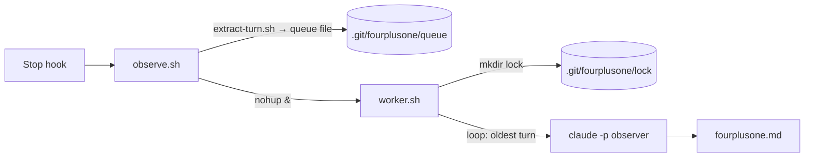

# fourplusone

[](https://github.com/adhikrysh/fourplusone/releases)
[](LICENSE)

A Claude Code plugin that keeps a live architecture map of your repo, and flags what your coding agent decided without telling you.

After every turn, it updates `fourplusone.md` at your repo root:

- **The views.** Your system in Kruchten's [4+1 view model](https://en.wikipedia.org/wiki/4%2B1_architectural_view_model): logical, process, development, physical, and scenarios. One diagram and a few lines each.
- **The sessions.** Every turn, step by step. Anything the agent decided or assumed out of sight gets a ⚠.

## Install

In Claude Code:

```
/plugin marketplace add adhikrysh/fourplusone
/plugin install fourplusone@fourplusone
```

Requires `git` and `jq` (`brew install jq` or `sudo apt install jq`).

## Usage

Work as usual. After your first turn, `fourplusone.md` appears. Keep its markdown preview open beside the terminal (`Cmd+K V` in VS Code or Cursor); it refreshes on every change.

- Runs in git repos only.
- The file is added to `.git/info/exclude`, so it is never committed.
- Diagrams are Mermaid. VS Code needs [Markdown Preview Mermaid Support](https://marketplace.visualstudio.com/items?itemName=bierner.markdown-mermaid).

## Example

fourplusone on its own repo, while the agent wrote an end-to-end test (the race it flags has since been fixed). Full file: [`examples/fourplusone.md`](examples/fourplusone.md).

A view (process):



> - Entry point: Claude Code `Stop` hook (`hooks/hooks.json`).
> - ⚠ Suspected race: worker A sees empty queue (`worker.sh:19`), then before its EXIT trap frees the lock (`:12`) a new `observe.sh` queues a turn and starts worker B. B fails `mkdir` (`:11`) and exits. The turn is stranded until a later turn. Claimed by agent, not reproduced.

A turn (trimmed):

> - **Asked:** "approved, go with all your recommendations" (decisions 1–9).
> - **Did:** tried to write `tests/e2e.sh`. Harness blocked it as a "sensitive file". Nothing on disk.
> - **⚠** Structure checks are looser than the "exact headings" it promised.
> - **⚠** Script refuses to run if fourplusone is installed globally. Could not verify; `plugin list` was blocked.

## How it works

```
agent turn ends
  → Stop hook (observe.sh) copies the turn into .git/fourplusone/queue, returns at once
  → worker.sh, in the background, feeds each turn to `claude -p --model sonnet`
  → Sonnet reads your code and edits fourplusone.md (and nothing else)
```

Sonnet runs on your Claude Code login: no API key, one Sonnet call per turn.

## Limits

- Claude Code only. Codex support is planned.
- Sees what the agent says and does, not its private reasoning.
- Misses your own edits until a later turn touches that code.

## Uninstall

```
/plugin uninstall fourplusone@fourplusone
```

Then delete `fourplusone.md` and `.git/fourplusone/` from any repo that has them.

## Contributing

Issues and pull requests welcome. The observer's instructions live in [`prompts/fourplusone.md`](prompts/fourplusone.md); the hook and worker are in [`scripts/`](scripts/).

## License

[MIT](LICENSE)
