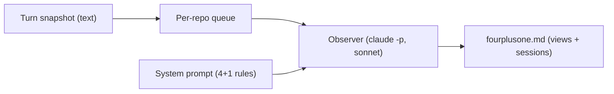
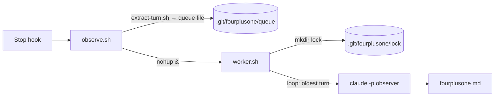
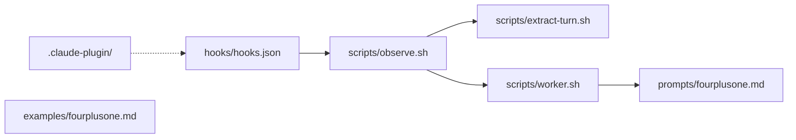
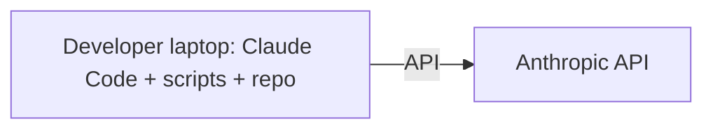

# fourplusone

## Logical
Boxes: domain concepts. Arrows: "produces / consumes".

- Doc has two parts: 5 views (present) + sessions (history). Defined in `prompts/fourplusone.md`.
- Observer may only Edit `./fourplusone.md` (`worker.sh:25`).
- No test concept exists yet. `tests/e2e.sh` is approved and drafted, but the write was blocked ("sensitive file"); not on disk.

## Process
Boxes: running things. Arrows: how they start each other.

- Entry point: Claude Code `Stop` hook (`hooks/hooks.json`).
- Observer's own session sets `FOURPLUSONE_OBSERVER` so the hook skips it (`observe.sh:7`).
- ⚠ Suspected race: worker A sees empty queue (`worker.sh:19`), then before its EXIT trap frees the lock (`:12`) a new `observe.sh` queues a turn and starts worker B. B fails `mkdir` (`:11`) and exits. The turn is stranded until a later turn. Claimed by agent, not reproduced.
- Turns are processed one at a time, oldest first.
- Failed observer run is logged and the turn is dropped (`worker.sh:28-29`).

## Development
Boxes: files. Arrows: calls.

- Needs `git` and `jq`. No jq → hook emits a system message and exits (`observe.sh:11`).
- `tests/` does not exist yet.
- `examples/fourplusone.md` is quoted by the README. Overwriting it from a test would make the README drift.
- No commits yet in the repo; everything is untracked.

## Physical
Boxes: machines. Arrows: network.

- All local. State lives in `.git/fourplusone/`. Doc is excluded via `.git/info/exclude` (`worker.sh:15`).
- Proposed test would run in a temp copy of the repo with `git init`.

## Scenarios
**Normal turn**
1. Developer ends a turn; Stop hook runs `observe.sh`.
2. `extract-turn.sh` writes the latest turn to the queue.
3. `observe.sh` starts `worker.sh` in the background and returns.
4. Worker takes the lock, runs the observer on the oldest turn.
5. Observer edits `fourplusone.md`; worker deletes the turn, loops until empty.

**Approved e2e test (drafted, not on disk)**
1. Copy repo to temp dir (rsync, no `.git`), `git init`; refuse if fourplusone is installed globally.
2. `claude -p --plugin-dir <real repo> --session-id U` turn 1; fail if queue empty.
3. Same with `--resume U` turn 2.
4. Poll 5s until queue empty and lock gone (900s cap); fail "stranded" if queue stays with no lock twice.
5. Loose heading checks, `
`, turns 1+2 mentioned; save artifacts to `examples/e2e/`.
Unverified: Stop hooks fire in `-p` mode; `--resume` keeps one transcript. Walking turn 2 through the Process view hits the race above.

---

# Sessions

<b>2026-11-06 · d9f0ef94</b> · Plan approved; <code>tests/e2e.sh</code> drafted but write blocked · <b>Waiting on you: allow the write to <code>tests/</code></b>

### Turn 1
- **Asked:** add `tests/e2e.sh`: real two-turn claude session with plugin loaded, wait for observer, save `fourplusone.md` to `examples/`.
- **Did:**
  - Listed repo files, read README and plugin manifest.
  - Read `observe.sh`, `worker.sh`, `extract-turn.sh`, `hooks.json`.
  - Read `claude --help` for flags (two Bash calls were blocked pending approval).
  - Listed headings of `examples/fourplusone.md`.
  - Replied with a plan and nine decisions. No files written.
- **⚠** Wants to run in a temp copy, not "this repo" as you asked.
- **⚠** Wants to save to `examples/e2e/`, not `examples/` as you asked.
- **⚠** Picked its own test scenario: a race in `worker.sh`. Says it is a real bug. Not reproduced.
- **⚠** Assumes Stop hooks fire under `-p` and `--plugin-dir` sets `CLAUDE_PLUGIN_ROOT`. Unverified. Says it will stop and tell you if false.
- **⚠** Pass criteria are structure only (headings present, no "observer failed", queue empty). Content quality is left to your eye.
- **Agreed:** nothing yet.

### Turn 2
- **Asked:** "approved, go with all your recommendations" (decisions 1–9).
- **Did:**
  - `claude plugin list` blocked pending approval (twice).
  - Grepped `prompts/fourplusone.md` for headings; read lines 85–114 (doc layout).
  - Tried to write `tests/e2e.sh`. Harness blocked it as a "sensitive file". Nothing on disk.
  - Replied with the drafted script and two changes.
- **⚠** Structure checks are looser than the "exact headings" it promised. Matches scope / goals / view / design guidelines / session case-insensitively, since the prompt names sections, not titles. "Needs you" not required.
- **⚠** `examples/e2e/` gets more than asked: `fourplusone.md`, `observer.log`, per-turn agent replies, observer input text. Folder wiped each run.
- **⚠** Script refuses to run if fourplusone is installed globally. Could not verify; `plugin list` was blocked.
- **⚠** Plugin loads from the real checkout via `--plugin-dir "$repo"`, so edits the test agent makes to the copy's `worker.sh` don't change the hook under test.
- **⚠** Fails fast as "turn stranded" if queue is non-empty and lock absent twice in a row. That is the suspected race, treated as a test failure.
- **Agreed:** decisions 1–9 approved by developer. Script not yet written. Open: approve the write or allow `tests/` edits; optional `git diff` capture of the turn-2 edit.

