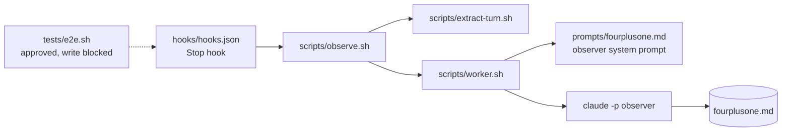
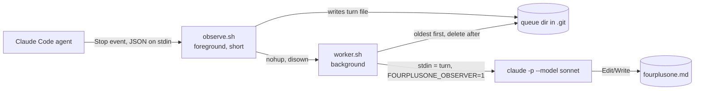

# fourplusone

## Needs you

- **`tests/e2e.sh` is still not on disk.** You approved all nine decisions ("go with all your recommendations"). The agent's `Write` was blocked: "Claude requested permissions to edit ... tests/e2e.sh which is a sensitive file." Approve the write (or allow edits under `tests/`) and the agent will write it. Nothing has been run yet.
- **Decision 5 was loosened by the agent, after your approval.** You approved exact heading checks (`## Needs you`, `## 3. Views`). The agent found `prompts/fourplusone.md:85-98` names the sections but not their titles, so it now matches headings case-insensitively on scope, goals, view, design guidelines, session; plus a `
` block, mentions of turn 1 and turn 2, no "observer failed" in the log, and `/fourplusone.md` in `.git/info/exclude`. It no longer requires "Needs you". Say if you want stricter checks.
- **Artifact folder grew (decision 2).** `examples/e2e/` will also hold the agent's reply per turn and the exact observer input per turn, saved before the worker deletes it. It is wiped each run; artifacts are saved before the checks, so a failed run is still inspectable.
- **Optional, waiting for a yes/no:** commit the temp copy at setup so the script can save `git diff` of turn 2's edit (proves "go ahead" really changed `worker.sh`). Left out for now.
- **Still unverified:** `claude plugin list` was blocked twice, so the agent does not know if fourplusone is installed globally (the script fails fast if so). Stop hooks firing in `claude -p` mode and `--resume` keeping one transcript are untested until the script runs. "No commits yet" (old claim) was never checked with `git log`.
- **Cannot confirm the draft matches its description.** The `Write` call shown to me is cut off mid-script, so the poll loop, strand check and checks list come from the agent's chat, not from code I saw.

---

## 1. Scope

A Claude Code plugin. After every agent turn (the Stop hook), it hands that turn to a second, background `claude -p` run. That run keeps one file, `fourplusone.md`, at the repo root, so the developer stays aligned with what the agent builds. (`README.md`: "keeps you aligned"; `.claude-plugin/plugin.json`.)

Current work in flight: a repeatable end-to-end test, `tests/e2e.sh`. Designed and approved, drafted, but the write was blocked, so it is not on disk.

## 2. Goals and constraints

- Never slow the agent: `observe.sh` returns at once and runs the worker in the background (`scripts/observe.sh:32-34`).
- One writer to `fourplusone.md` per repo: a lock directory (`scripts/worker.sh:11`).
- Never loop: the observer's own session fires the Stop hook too, ignored via `FOURPLUSONE_OBSERVER` (`observe.sh:7`).
- Doc stays out of git via `.git/info/exclude`, not `.gitignore` (`worker.sh:15-16`).
- Observer may only edit `./fourplusone.md` (`worker.sh:25`).
- Only git repos get a doc (`observe.sh:23`).
- Needs `jq`, `git`, `claude`, `bash` on PATH (`observe.sh:11-14` handles missing jq).
- Test rules from the developer's `AGENTS.md`: end-to-end tests only, medium-to-hard scenario, end with a repeatable artifact. Nothing is committed without permission.

## 3. Views

Small system, a few shell scripts, no server. Logical and development views are merged. The physical view is one machine.

### Logical + development view (merged)

Boxes are files. Arrows mean "calls".

- A **turn** = the developer's last message plus everything the agent did after it, as text, tool results cut at 3000 chars (`extract-turn.sh:18`).
- **Queue**: `.git/fourplusone/queue/<epoch>-<pid>-<session>.txt` (`observe.sh:28`). Also `.git/fourplusone/log` and `lock/`.
- Repo files: `hooks/`, `scripts/`, `prompts/`, `examples/fourplusone.md` (curated sample quoted by the README), `.claude-plugin/{plugin,marketplace}.json`, `README.md`, `LICENSE`.
- Planned (approved): `tests/e2e.sh`, `examples/e2e/` (holds `fourplusone.md`, `observer.log`, per-turn agent replies, per-turn observer input).

### Process view

Boxes are processes. Arrows are how they talk.

Entry point: one, the Stop hook running `scripts/observe.sh` (`hooks/hooks.json`).

Failure behavior: if the observer `claude -p` fails, the worker logs "observer failed" and still deletes that turn (`worker.sh:28-29`), so a failed turn is lost, not retried.

**Known race (found by the agent by reading, not yet reproduced):** worker A sees the queue empty at `worker.sh:19` and leaves the loop. Before its EXIT trap removes the lock (`worker.sh:12`), a new Stop hook adds a turn file and starts worker B. B's `mkdir` fails (`worker.sh:11`) and B exits. The new turn sits in the queue until a later turn starts another worker. I agree the code allows this.

### Physical view

One box: the developer's machine. The observer calls Anthropic's API through `claude`. For the planned test, a second box: a temp directory from `mktemp -d` with its own `git init` (approved).

### Scenarios

**Normal turn.**
1. Agent finishes a turn; Claude Code fires the Stop hook.
2. `observe.sh` extracts the turn and writes it to the queue.
3. It starts `worker.sh` in the background and returns.
4. The worker takes the lock, runs the observer on the oldest turn, deletes it.
5. The observer edits `fourplusone.md`. Queue empty, lock released.

**Planned e2e test (approved; per the agent's description, script not on disk).**
1. Fail if a tool is missing or `claude plugin list` shows `fourplusone@`. `rsync` the repo to a temp dir (no `.git`, no root `fourplusone.md`, no `examples/e2e`), `git init`.
2. Turn 1: `claude -p --session-id <uuid> --plugin-dir <repo> --model sonnet --tools Read,Edit,Write,Glob,Grep --permission-mode acceptEdits "<find the lock hand-off race, don't edit>"`. Fail if the queue is empty afterwards (Stop hook did not fire).
3. Turn 2 straight away, no waiting: same flags with `--resume <uuid>` and "Yes, go ahead with that fix."
4. Poll every 5s until queue empty and lock gone, 900s limit. Queue non-empty with no lock twice in a row = "turn stranded" (the race below), fail at once.
5. Save artifacts to `examples/e2e/` first, then run structure checks. Delete the temp dir on pass, keep and print its path on fail.

Walking this through the views: step 3 can hit the known race and strand turn 2. The agent chose to make that a loud failure rather than hide it. It means a flaky-looking fail may be a real bug.

## 4. Design guidelines

- Observer is read-only except `./fourplusone.md` (existing).
- Approved by the developer (2026-11-06, "go with all your recommendations"), proposed by the agent: test in a temp copy; artifact in `examples/e2e/`; structural asserts only, no golden match since LLM output varies; fail if fourplusone is globally installed (its hook would queue every turn twice); test agent on Sonnet with no Bash.
- Agent-made after approval, not yet confirmed: heading checks are loose (case-insensitive keywords), not the exact titles approved.

---

## Sessions

<b>2026-11-06 20:38 · session d9f0ef94 · Turn 2: you approved all 9; script drafted but the write was blocked; needs your OK to write it</b>

### Turn 2

**Developer said:** "approved, go with all your recommendations."

**What the agent did, in order:**

1. Ran `claude plugin list 2>&1 | head -40`. **Blocked** (piped command needs approval).
2. Ran plain `claude plugin list`. **Blocked** ("requires approval"). So whether fourplusone is installed globally is still unknown.
3. Ran `grep -n '#' prompts/fourplusone.md | head -40` to see the observer prompt's headings. Result: the prompt's own headings (lines 3-111). It names no required doc titles.
4. Read `prompts/fourplusone.md:85-114` ("The doc"). Confirmed it lists Scope, Goals, Views, Design guidelines, Sessions by name only.
5. Called `Write` on `tests/e2e.sh`. **Blocked**: "sensitive file". Nothing on disk. (The call shown to me is cut off mid-script.)
6. Replied with a description of the draft and two changes from the approved plan.

**Decided or assumed without you seeing it:**
- ⚠ Loosened decision 5: no exact `## Needs you` / `## 3. Views` match. Reason given: the prompt does not fix titles, so exact matching would flake. Sound reason (I checked step 4), but it differs from what you approved.
- ⚠ Expanded `examples/e2e/` contents beyond what decision 2 listed (per-turn agent replies and observer input).
- ⚠ Dropped the requirement for a "Needs you" section.
- Left out `git diff` of turn 2's edit. Offered as an option.
- Did not hit the harness block by design; it asked you to approve the write or allow edits under `tests/`.

**Agreed:** all nine plan decisions, with "all your recommendations". **Not yet agreed:** the two changes above (the agent disclosed them).

**Open:** approve the write to `tests/e2e.sh`; yes/no on the `git diff` add-on; stricter heading checks or not.

<b>2026-11-06 20:36 · session d9f0ef94 · Turn 1: agent read everything, wrote nothing, needs approval of 9 decisions</b>

### Turn 1

**Developer asked:** "add tests/e2e.sh: a repeatable end-to-end test that runs a real two-turn claude session in this repo with the plugin loaded, waits for the observer to finish, and saves the resulting fourplusone.md to examples/."

**What the agent did, in order:**

1. Ran one Bash to list repo files and read the README, plugin manifest, and `ls` of `hooks scripts prompts examples`. Result: 10 files, no tests dir, README partly cut.
2. Ran a second Bash combining `cat -n` of four scripts, `head` of the example, and `claude --version; claude --help | grep`. **Blocked** ("a variable in this command can't be checked").
3. Read `scripts/observe.sh`, `worker.sh`, `extract-turn.sh`, `hooks/hooks.json` with the Read tool instead.
4. Tried `claude --version; claude --help | grep ...`. **Blocked** (compound command needs approval).
5. Ran plain `claude --help`. Output was cut at 3000 chars, so the agent saw only the start of the flag list (`--bg`, `--bare`, `--allowedTools` etc.); the later flags it relies on (`--plugin-dir`, `--session-id`, `--resume`, `--permission-mode`) were not visible in the captured output. It still cites them in the plan.
6. Ran `grep -n '^#' examples/fourplusone.md` to see the doc's heading shape (used for the pass-criteria headings).
7. Wrote the plan in chat and stopped. No file was created or edited.

**Decided or assumed without you seeing it** (now surfaced in the plan, but not yet approved):
- ⚠ Replaced "in this repo" with a temp copy (reason given: safety and repeatability).
- ⚠ Replaced "save to examples/" with `examples/e2e/` (reason given: don't make the README drift).
- ⚠ Chose a race in `worker.sh` as the "medium-to-hard" scenario. Reason: it is real in the code.
- ⚠ Assumed `--plugin-dir`, `--session-id`, `--resume`, `acceptEdits` exist as flags. Not confirmed in visible output.
- ⚠ Assumed "no commits yet". No command shown.
- Assumed Stop hooks run before `claude -p` exits, so the turn is queued when the call returns. Stated as an assumption to verify.

**Agreed:** nothing yet. The agent explicitly asked for approval and said it would not commit.

**Open:** all of the "Needs you" list above.

